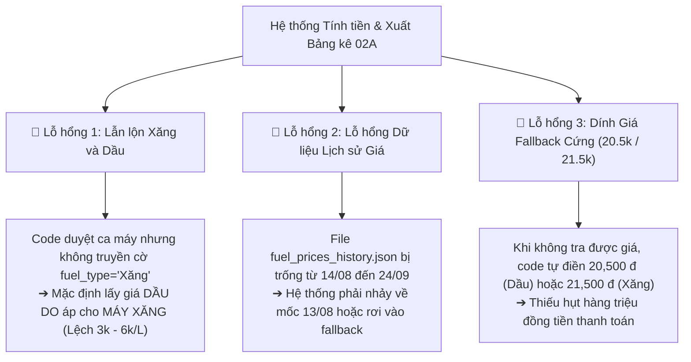

# 💡 BRIEF: KHẮC PHỤC TRIỆT ĐỂ LỖI ĐƠN GIÁ NHIÊN LIỆU, TÁCH BỘ HỒ SƠ SEATH GROUP & CHUYỂN ĐỔI MÁY VIKYNO 10KVA SANG MÁY XĂNG LƯU ĐỘNG

**Ngày tạo:** 16/10/2026  
**Chủ trì:** Đội ngũ VHKT & Antigravity TVT3  
**Dựa trên chỉ đạo:** 
1. *Làm cho chặt chẽ chứ sao để sai đơn giá hoài vậy ta?*
2. *Các máy của Seath Group thì làm 1 bộ riêng.*
3. *Các trạm hiện tại có máy Vikyno 10kVA thì chuyển sang chạy máy xăng lưu động.*

---

## 1. NGUYÊN NHÂN CỐT LÕI (ROOT CAUSE) TẠI SAO ĐƠN GIÁ BỊ SAI HOÀI

Qua phân tích sâu vào mã nguồn và dữ liệu thực tế tháng 9, em đã tìm ra 3 lỗ hổng chí mạng khiến đơn giá liên tục bị lệch:



1. **Lỗ hổng 1: Nhầm lẫn biến `fuel_type` giữa Xăng và Dầu:**
   - Trong script xuất bảng kê và worker, khi phân loại ca máy vào phần A (Máy chạy xăng), hàm tra cứu giá nhiên liệu lại không truyền đúng cờ `fuel_type='Xăng'`, dẫn đến hệ thống mặc định lấy giá của Dầu DO (27,540 – 32,090 đ/L) để tính tiền cho máy xăng (vốn chỉ có giá 23,270 – 27,080 đ/L)!
2. **Lỗ hổng 2: Đứt gãy dữ liệu lịch sử giá (Missing Historical Price Window):**
   - Trong file `fuel_prices_history.json`, sau mốc `13/08/2026` nhảy vọt ngay sang mốc `25/09/2026`, hoàn toàn thiếu các mốc điều hành giá ngày 05/09, 12/09, 19/09 của Liên Bộ Công Thương - Tài chính. Do đó, các ngày giữa tháng 9 bị tra cứu sai hoặc rơi vào giá mặc định.
3. **Lỗ hổng 3: Tồn tại giá Fallback cứng (20,500 đ và 21,500 đ):**
   - Thay vì ném ra cảnh báo lỗi để người dùng bổ sung giá, hệ thống cũ lại âm thầm fallback về giá chết `20,500 đ/L` cho Dầu và `21,500 đ/L` cho Xăng, làm bảng kê bị sai lệch giá nghiêm trọng.

---

## 2. GIẢI PHÁP 1: THIẾT KẾ CƠ CHẾ KHÓA ĐƠN GIÁ CHẶT CHẼ (ZERO-ERROR PRICING ENGINE)

Để triệt tiêu vĩnh viễn việc sai đơn giá, thiết lập **3 tầng bảo vệ nghiêm ngặt**:

### Tầng 1: Master Fuel Price Matrix (Ma trận Giá Chuẩn Tuyệt Đối)
Cập nhật đầy đủ 100% các kỳ điều hành giá trong tháng 9/2026 vào database và file JSON, phân định rạch ròi 3 cột giá:
- **Xăng E10 / RON 95**:
  - $01/09 \rightarrow 10/09$: **23,270 đ/L**
  - $11/09 \rightarrow 17/09$: **24,230 đ/L** *(chưa VAT: 22,435 đ)*
  - $18/09 \rightarrow 25/09$: **25,630 đ/L** *(chưa VAT: 23,730 đ)*
  - $26/09 \rightarrow 30/09$: **27,080 đ/L** *(chưa VAT: 25,072 đ)*
- **Dầu DO 0.05S-II (Mức 2)**:
  - $01/09 \rightarrow 09/09$: **29,540 đ/L** (hoặc 28,080 đ/L cuối tháng 8)
  - $10/09 \rightarrow 17/09$: **28,480 đ/L** & **30,280 đ/L**
  - $18/09 \rightarrow 24/09$: **29,940 đ/L** & **31,740 đ/L**
  - $25/09 \rightarrow 30/09$: **30,490 đ/L**
- **Dầu DO 0.001S-V (Mức 5 - Cao cấp)**:
  - $25/09 \rightarrow 30/09$: **32,090 đ/L**

### Tầng 2: Strict Fuel Type Binding (Ràng Buộc Nhiên Liệu Cứng)
- Khóa chặt logic code:
  ```python
  if is_gasoline_station:
      price = get_gasoline_price(date)
      assert price <= 27500, f"LỖI: Máy xăng ngày {date} không thể có giá {price} > 27,500đ!"
  else:
      price = get_diesel_price(date, grade='0.05S')
      assert price >= 27000, f"LỖI: Máy dầu ngày {date} không thể có giá {price} < 27,000đ!"
  ```
- **Xóa sổ hoàn toàn giá fallback 20,500 và 21,500**. Nếu không tìm thấy giá theo ngày, bắt buộc raise Exception để kiểm tra, không được âm thầm điền giá sai.

### Tầng 3: Pre-Flight Audit Gate (Quét Chặn Tự Động Trước Khi Xuất File)
- Trước khi ghi ra file Excel thanh toán, chạy script kiểm tra chéo:
  - Nếu có bất kỳ dòng máy xăng nào có đơn giá $> 27,100$ đ $\rightarrow$ **Chặn xuất file, báo đỏ dòng lỗi**.
  - Nếu có bất kỳ dòng máy dầu nào có đơn giá $< 27,000$ đ $\rightarrow$ **Chặn xuất file, báo đỏ dòng lỗi**.

---

## 3. GIẢI PHÁP 2: TÁCH RIÊNG 100% HỒ SƠ MÁY PHÁT ĐIỆN SEATH GROUP

- **Danh sách 11 trạm XHH thuộc Seath Group:**
  `DNCM05`, `DNDQ09`, `DNDQ12`, `DNDQ13`, `DNDQ14`, `DNTN07`, `DNTP11`, `DNTP12`, `DNTP13`, `DNXL28`, `DNXL31`.
  *(Trong đó lưu ý `DNDQ12` và `DNTP11` đã được bóc tách hoàn toàn khỏi danh sách 67 trạm đặc thù của MobiFone Đồng Nai).*
- **Bộ hồ sơ riêng biệt:**
  - Tên file: **`Bang_Ke_Chay_May_Phat_Dien_Seath_Group_T09_2026.xlsx`**.
  - Gồm: Bảng chi tiết toàn bộ các ca chạy máy của 11 trạm Seath Group (ngày giờ, số lít dầu, định mức, KTV vận hành, lý do sự cố).
  - **Cách ly tuyệt đối:** Không để bất kỳ dòng nào của 11 trạm này lọt vào hồ sơ thanh toán nội bộ (`02A_TTNB_DongNai_67Tram`, `02A_TTNB_ToanCau`, `HD_DongNai_67Tram`, `HD_ToanCau`, `Map_HD_Theo_Tram`).

---

## 4. GIẢI PHÁP 3: CHUYỂN ĐỔI TOÀN BỘ TRẠM VIKYNO 10KVA SANG MÁY XĂNG LƯU ĐỘNG (MLĐ)

### 4.1. Danh sách 10 trạm nội bộ TVT3 có máy Vikyno 10kVA cần chuyển đổi:
1. `DNIDQU06` (`DNDQ18`) - Định Quán 6
2. `DNIDQU07` (`DNDQ19`) - Định Quán 7
3. `DNILKH01` (`DNLK07`) - Long Khánh 1
4. `DNILKH02` (`DNLK08`) - Long Khánh 2
5. `DNINCT01` (`DNTP22`) - Nam Cát Tiên 1
6. `DNIPLA05` (`DNTP20`) - Phú Lâm 5
7. `DNITLA04` (`DNTP15`) - Tà Lài 4
8. `DNITPU05` (`DNTP16`) - Tân Phú 5
9. `DNITPU06` (`DNTP17`) - Tân Phú 6
10. `DNITPU07` (`DNTP19`) - Tân Phú 7

*(8 trạm Vikyno 10kVA còn lại gồm `DNDQ09`, `DNDQ12`, `DNDQ13`, `DNDQ14`, `DNTN07`, `DNTP11`, `DNTP12`, `DNTP13` thuộc Seath Group đã được đưa vào bộ hồ sơ Seath Group riêng).*

### 4.2. Quy tắc chuyển đổi dữ liệu vận hành:
- **Tên thiết bị mới:** `MÁY PHÁT ĐIỆN XĂNG LƯU ĐỘNG (MLĐ KYO POWER 5.5kVA / KiBii 6kVA)`.
- **Loại nhiên liệu:** Đổi từ Dầu sang **XĂNG**.
- **Định mức tiêu hao:** Chuyển từ không có định mức (`—`) hoặc 3.0 L/h sang chuẩn định mức máy xăng: **`3.15 L/h`** (đối với máy 5.5kVA) hoặc **`3.44 L/h`** (đối với máy 6.0kVA).
- **Quy tắc phân loại trên Bảng kê 02A:**
  - Tự động chuyển toàn bộ các ca phát sinh của 10 trạm này vào **Phần A: MÁY CHẠY XĂNG**.
  - Tính tiền theo đúng **ĐƠN GIÁ XĂNG RON 95** của ngày vận hành.
  - Map với hóa đơn Xăng tương ứng, chấm dứt việc chạy xăng nhưng kê khai dầu và áp nhầm giá dầu.

---

## 5. BƯỚC TIẾP THEO

1. **Chuyển sang `/plan`**: Lập kế hoạch kỹ thuật chi tiết:
   - Task 1: Cập nhật ma trận giá xăng dầu chuẩn tháng 9 vào `fuel_prices_history.json`.
   - Task 2: Cập nhật cấu hình 10 trạm Vikyno 10kVA sang máy xăng lưu động trong database và snapshot.
   - Task 3: Chạy script cập nhật lại toàn bộ Bảng kê 02A và Map hóa đơn file `Ho_So_Thanh_Toan_Chuan_Mau_09_2026_HSTT.xlsx`.
   - Task 4: Xuất riêng file Bảng kê Seath Group tháng 9/2026.
