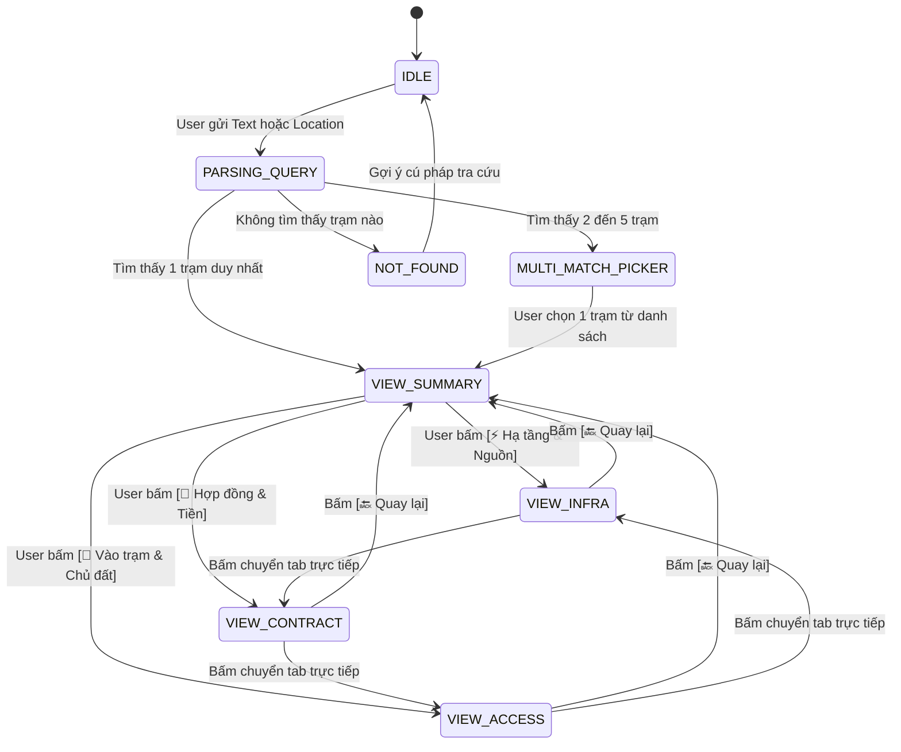

# 🎨 DESIGN: Thiết Kế Kỹ Thuật Module Telegram Bot DataSite & Hợp Đồng TVT3

**Ngày tạo:** 07/10/2026  
**Module:** `backend/bots/` (`site_contract_bot`)  
**Tác giả:** Antigravity Solution Architect & Cang_IT  
**Trạng thái:** Approved Architecture Design  

---

## 1. TỔNG QUAN KIẾN TRÚC HỆ THỐNG

### 1.1. Sứ mệnh module
Cung cấp kênh tra cứu siêu tốc, tin cậy, bảo mật trực tiếp trên Telegram cho kỹ sư/KTV tại hiện trường:
- Không phụ thuộc vào Web Dashboard phức tạp khi đang ngoài trời/ứng cứu sự cố.
- Tập trung 100% vào **DataSite (Hạ tầng, Nguồn, MPD, Ắc quy)** và **Hợp đồng (Chủ đất, Tiền thuê, Chìa khóa, Pháp lý)**.
- Phản hồi **< 0.1 giây** nhờ kiến trúc In-Memory Snapshot Cache.

### 1.2. Sơ đồ khối kiến trúc (Component Diagram)

```
       [ KTV Hiện Trường ]
      (Gõ mã / Tên / GPS)
               │
               ▼
      [ Telegram API Cloud ]
               │ (Long Polling / Asyncio)
               ▼
┌───────────────────────────────────────────────────────────┐
│              BACKEND BOT ENGINE (backend/bots/)           │
│                                                           │
│  ┌────────────────────┐      ┌─────────────────────────┐  │
│  │   Auth Middleware  │ ───► │  Smart Search Parser    │  │
│  │ (Whitelist & Roles)│      │  (Regex, Unaccent, GPS) │  │
│  └────────────────────┘      └────────────┬────────────┘  │
│                                           │               │
│                                           ▼               │
│  ┌─────────────────────────────────────────────────────┐  │
│  │     SITE CONTRACT RESOLVER (Bộ Giải Mã Dữ Liệu)     │  │
│  │  - FIELD_SITE_ID   : Mã trạm, Địa chỉ, QLT, Cột/Nhà │  │
│  │  - FIELD_INFRA     : PE EVN, MPD, Ắc quy, Cáp quang │  │
│  │  - FIELD_CONTRACT  : Số HĐ, Hạn HĐ, Tiền thuê, STK  │  │
│  │  - FIELD_ACCESS    : SĐT chủ đất, Mật mã khóa số    │  │
│  └────────────────────────┬────────────────────────────┘  │
│                           │                               │
│                           ▼                               │
│  ┌─────────────────────────────────────────────────────┐  │
│  │      IN-MEMORY SNAPSHOT CACHE (412 Trạm TVT3)       │  │
│  │  - Index: site_id, site_id_old, unaccent_name       │  │
│  │  - Geospatial: Haversine Lat/Lon Calculator         │  │
│  │  - Auto-Refresh: 60 phút / Sync từ Supabase         │  │
│  └────────────────────────┬────────────────────────────┘  │
└───────────────────────────┼───────────────────────────────┘
                            │ (HTTPS / Supabase Client)
                            ▼
               ┌────────────────────────┐
               │     SUPABASE TVT3      │
               │   Table: datasites     │
               └────────────────────────┘
```

---

## 2. DATABASE MAPPING & DATA RESOLUTION

Tất cả dữ liệu được đọc từ **bảng `datasites` duy nhất** trên Supabase (nơi đã thống nhất cả hồ sơ trạm và thông tin hợp đồng).

### 2.1. Cấu trúc trường ánh xạ (Schema Mapping Table)

| Domain | Trường hiển thị Bot | Cột trong bảng `datasites` | Đường dẫn JSONB / Kiểu | Ghi chú xử lý |
|---|---|---|---|---|
| **Định danh** | Mã trạm mới | `site_id` | `VARCHAR(50)` | Uppercase, làm key chính |
| | Mã trạm cũ | `site_id_old` | `VARCHAR(50)` | Cho phép tìm kiếm cả mã cũ |
| | Tên trạm | `name` | `TEXT` | Bỏ dấu khi tìm kiếm |
| | Trạng thái trạm | `status` | `VARCHAR(50)` | Phát sóng / MLL / Tạm dừng |
| | Tổ quản lý | `management_info` | `->>'to_ql'` | TỔ 3 |
| | Người QLT | `management_info` | `->>'qlt'` | Tên KTV phụ trách |
| | Cột & Chiều cao | `classification` | `->>'loai_cot'`, `->>'chieu_cao_cot'` | VD: Cột tự đứng 42m |
| | Nhà trạm | `classification` | `->>'loai_nha'` | Shelter / Nhà xây |
| | Địa chỉ | `location_info` | `->>'xa_moi'`, `->>'huyen'` | Bỏ đuôi ", Đồng Nai" |
| | Tọa độ GPS | `location_info` | `->>'kinh_do'`, `->>'vi_do'` | Dùng mở Google Maps & quét GPS |
| **Hạ tầng** | Mã PE Điện lực | `management_info` | `->>'ma_pe'` | Mã khách hàng EVN (copy nhanh) |
| | Máy phát điện | `infrastructure_info` | `->'may_phat_dien'` | Loại MPD, Công suất, Định mức L/h |
| | Ắc quy | `infrastructure_info` | `->'ac_quy'` | Loại bình (Lithium/Axit), Dung lượng Ah |
| | Máy lạnh | `infrastructure_info` | `->'may_lanh'->'dhkk'` | Số lượng máy lạnh, công suất |
| | Truyền dẫn | `technical_info` | `->>'last_mile_primary'`, `->>'huong_ket_noi'` | Trạm nguồn, Ring Metro |
| **Hợp đồng** | Số hợp đồng | `contract_number` | `TEXT` | Số HĐ thuê trạm |
| | Chủ thể ký HĐ | `contract_info` | `->'contractor_info'->>'chu_the_hop_dong'` | Tên chủ đất |
| | Ngày bắt đầu | `contract_info` | `->'dates'->>'ngay_ky_hd'` | Định dạng DD/MM/YYYY |
| | Ngày hết hạn | `contract_info` | `->'dates'->>'ngay_ket_thuc_hd'` | Tính số ngày còn lại & gán Badge |
| | Đã trả tiền đến | `contract_info` | `->'dates'->>'ngay_thanh_toan_den'` | Trạng thái công nợ |
| | Chu kỳ thanh toán | `contract_info` | `->'dates'->>'chu_ky_thanh_toan'` | 3 tháng, 6 tháng, 1 năm |
| | Giá thuê có VAT | `contract_info` | `->'financials'->>'gia_thue_co_vat'` | Định dạng tiền tệ VNĐ |
| | Giá điện khoán | `contract_info` | `->'financials'->>'gia_dien_khoan'` | Tiền điện khoán tháng |
| | Số tài khoản NH | `contract_info` | `->'bank_info'->>'so_tai_khoan'` | Monospace click-to-copy |
| | Ngân hàng | `contract_info` | `->'bank_info'->>'ngan_hang'` | Tên ngân hàng & chi nhánh |
| **Vào trạm** | SĐT chủ nhà | `contract_info` | `->'contractor_info'->>'sdt_chu_nha'` | Gắn link `tel:` hoặc `tg://call` |
| | Mật mã khóa số | `contract_info` | `->'access_info'->>'mat_khau_khoa_so'` | Mật mã ổ khóa cổng |
| | Người giữ chìa | `contract_info` | `->'access_info'->>'nguoi_giu_chia'` | Vị trí gửi chìa / người giữ |
| | Chỉ dẫn đường vào | `contract_info` | `->'access_info'->>'ghi_chu_vao_tram'` | Đường hẻm, đi bộ, dốc, chó dữ |

---

## 3. STATE MACHINE & FLOW LOGIC

### 3.1. Các trạng thái hội thoại (Conversation States)



### 3.2. Thuật toán tìm kiếm thông minh (Smart Search Algorithm)
1. **Bước 1: Kiểm tra vị trí GPS (Live Location):**
   - Nếu `update.message.location` tồn tại:
   - Duyệt mảng 412 trạm trong RAM, tính khoảng cách Haversine:
     $$d = 2r \arcsin\left(\sqrt{\sin^2\left(\frac{\Delta \phi}{2}\right) + \cos(\phi_1)\cos(\phi_2)\sin^2\left(\frac{\Delta \lambda}{2}\right)}\right)$$
   - Lọc trạm có khoảng cách nhỏ nhất. Nếu $d \le 500\text{m}$ -> Tự động mở Thẻ Tóm Tắt trạm đó kèm khoảng cách!
2. **Bước 2: Tìm kiếm theo mã trạm chính xác (Exact Code Match):**
   - Chuẩn hóa: `query.strip().upper()`
   - Kiểm tra trong `site_id_index` và `site_id_old_index`. Nếu khớp 100% -> Trả về ngay.
3. **Bước 3: Tìm kiếm theo tên trạm hoặc tên chủ nhà (Fuzzy / Unaccent Match):**
   - Bỏ dấu tiếng Việt (`unidecode`) và chuyển chữ thường.
   - Tìm kiếm trạm có tên chứa từ khóa.
   - Nếu có 1 kết quả -> Mở thẻ tóm tắt.
   - Nếu có từ 2 đến 5 kết quả -> Mở bộ chọn trạm (Multi-Match Picker).
   - Nếu > 5 kết quả -> Yêu cầu nhập thêm ký tự để thu hẹp phạm vi.

---

## 4. IN-MEMORY SNAPSHOT CACHE SPECIFICATION

```python
class SiteCacheManager:
    def __init__(self):
        self.sites_by_id = {}        # { "26DNA_LK00": site_dict }
        self.sites_by_old_id = {}    # { "DNLK00": site_dict }
        self.all_sites = []          # [ site_dict, ... ]
        self.last_sync = None
        
    async def sync_from_supabase(self):
        """Fetch 412 sites from Supabase datasites table into RAM."""
        # Query: supabase.from('datasites').select('*')
        # Build indexes and cache locally in < 0.5s
        
    def find_nearest(self, lat: float, lon: float, max_km: float = 1.0):
        """Find the closest site within max_km using Haversine formula."""
```

* **Bộ nhớ tiêu thụ:** ~3.2 MB RAM cho toàn bộ 412 trạm (cực kỳ nhẹ).
* **Chu kỳ làm mới:** 60 phút/lần hoặc tức thì qua lệnh `/sync` của Admin.
* **Tính khả dụng:** Nếu Supabase mất mạng tạm thời, bot vẫn tiếp tục phục vụ bình thường từ Snapshot Cache.

---

## 5. BẢO MẬT & PHÂN QUYỀN (SECURITY & ROLES)

* **Whitelist Users:** Đọc từ bảng `allowed_users` hoặc biến môi trường `TELEGRAM_ALLOWED_USERS`.
* **Phân quyền:**
  * `ADMIN`: Toàn quyền, nhận cảnh báo lỗi, chạy lệnh `/sync`, `/reload`, xem log.
  * `KTV`: Tra cứu trạm, xem hạ tầng, xem hợp đồng, lấy chìa khóa, xem SĐT chủ nhà.
  * `GUEST` (Chưa phê duyệt): Bị chặn lệnh tra cứu, hiển thị thông báo "Tài khoản của bạn chưa được cấp quyền truy cập dữ liệu mạng TVT3. Vui lòng liên hệ Admin".

---

## 6. XỬ LÝ LỖI & PHÒNG NGỪA RỦI RO (RESILIENCE)

1. **Telegram API Rate Limit (429 Too Many Requests):** Bọc gửi tin nhắn qua `asyncio.sleep` và cơ chế Retry có Exponential Backoff.
2. **Message Edit Not Modified:** Bắt lỗi Telegram khi KTV bấm 2 lần vào cùng 1 nút Inline Keyboard, tránh crash bot.
3. **Trường dữ liệu rỗng (Null / None):** Hàm format luôn gán giá trị mặc định `"Chưa cập nhật"` hoặc `"Không có"`, không bao giờ để xảy ra `AttributeError` hoặc crash chuỗi.
