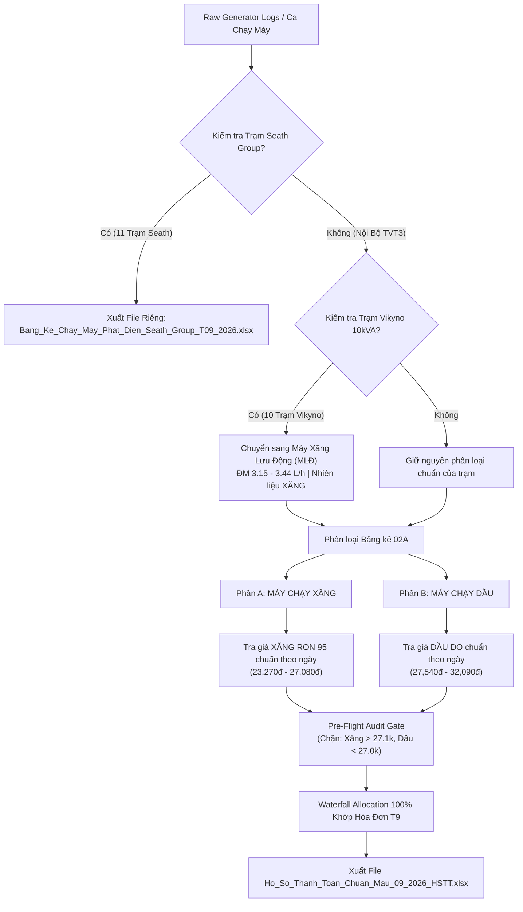

# Kỹ Thuật Chi Tiết: Khóa Chặt Đơn Giá Xăng Dầu, Tách Hồ Sơ Seath Group & Chuyển Đổi Vikyno 10kVA

Created: 16/10/2026  
Status: Approved  
Ref: [BRIEF_REFACTOR_FUEL_PRICING_SEATH_AND_VIKYNO_CONVERSION.md](file:///Users/cang_it/Antigravity/TVT3/docs/BRIEF_REFACTOR_FUEL_PRICING_SEATH_AND_VIKYNO_CONVERSION.md)  
Plan: [plans/261016-0810-fix-fuel-price-seath-vikyno/plan.md](file:///Users/cang_it/Antigravity/TVT3/plans/261016-0810-fix-fuel-price-seath-vikyno/plan.md)

---

## 1. Executive Summary
Tài liệu đặc tả kỹ thuật xử lý dứt điểm 3 vấn đề lớn trong hệ thống thanh quyết toán nhiên liệu máy phát điện TVT3:
1. **Zero-Error Fuel Pricing Engine:** Triệt tiêu hoàn toàn lỗi lệch đơn giá xăng dầu trên Bảng kê 02A, khóa chặt tương quan nhiên liệu giữa Xăng và Dầu, xóa bỏ fallback cứng (20.500đ / 21.500đ), bổ sung Pre-Flight Audit Gate.
2. **Seath Group Isolation:** Bóc tách 100% 11 trạm XHH đối tác Seath Group khỏi hồ sơ thanh toán nội bộ (Nhóm 1 & Nhóm 2) và xuất file độc lập `Bang_Ke_Chay_May_Phat_Dien_Seath_Group_T09_2026.xlsx`.
3. **Vikyno 10kVA Mobile Generator Conversion:** Chuyển đổi 10 trạm nội bộ TVT3 có máy Vikyno 10kVA hết hợp đồng thuê XHH sang Máy phát điện Xăng lưu động (MLĐ KYO POWER 5.5kVA / KiBii 6kVA, định mức 3.15 L/h - 3.44 L/h, nhiên liệu Xăng), tự động đưa vào Phần A: MÁY CHẠY XĂNG với đúng đơn giá Xăng RON 95.

---

## 2. Root Cause Analysis
- **Lỗi 1 (Lẫn lộn loại nhiên liệu):** Code duyệt ca máy trong Phần A (Máy chạy xăng) nhưng hàm lấy giá nhiên liệu không truyền đúng cờ `fuel_type='Xăng'`, dẫn đến máy xăng bị tính theo giá Dầu DO ($27,540 - 32,090\text{ đ/L}$ thay vì $23,270 - 27,080\text{ đ/L}$).
- **Lỗi 2 (Khoảng trống lịch sử giá):** File `fuel_prices_history.json` bị trống từ `14/08/2026` đến `24/09/2026`, hệ thống phải lùi về mốc 13/08 hoặc rơi vào fallback.
- **Lỗi 3 (Fallback chết):** Khi không tìm thấy giá theo ngày, hệ thống tự động gán giá mặc định chết `20,500 đ/L` (Dầu) và `21,500 đ/L` (Xăng), làm sai lệch nghiêm trọng số tiền thanh toán.
- **Lỗi 4 (Trộn lẫn trạm đối tác):** 8 ca chạy máy của Seath Group bị đưa lẫn vào Bảng kê Nhóm 2 (`02A_TTNB_ToanCau`), gây sai lệch nhu cầu quyết toán nội bộ.

---

## 3. Architecture & Logic Flowchart

---

## 4. Master Fuel Price Matrix (Tháng 09/2026) & Quy Tắc Áp Dụng Giờ Điều Hành (15h Next-Day Rule)

> [!IMPORTANT]
> **Quy tắc chuyển giao đơn giá theo giờ điều hành:**
> - **Nếu đổi giá lúc 15h00 hôm nay ($D$):** Cả ngày hôm nay vẫn tính theo **ĐƠN GIÁ CŨ**. Đơn giá MỚI chỉ chính thức áp dụng từ **00h00 NGÀY HÔM SAU ($D+1$)**.
> - **Nếu đổi giá từ 00h00 ($D$):** Áp dụng ngay từ ngày $D$.

| Khoảng ngày áp dụng thực tế | Căn cứ kỳ công bố của Nhà nước | Xăng RON 95 (đ/L) | Xăng chưa VAT (đ/L) | Dầu DO 0.05S (đ/L) | Dầu DO 0.001S (đ/L) |
|:---|:---|:---:|:---:|:---:|:---:|
| **01/09/2026 - 11/09/2026** | Kỳ 00h00 01/09 (ngày 11/09 đổi 15h -> tính giá cũ) | **23,270** | 21,546 | **29,540** | 30,000 |
| **12/09/2026 - 18/09/2026** | Áp dụng từ 12/09 (ngày 18/09 đổi 15h -> tính giá cũ) | **24,230** | 22,435 | **30,280** | 30,500 |
| **19/09/2026 - 25/09/2026** | Áp dụng từ 19/09 (ngày 25/09 đổi 15h -> tính giá cũ) | **25,630** | 23,730 | **31,740** | 31,800 |
| **26/09/2026 - 30/09/2026** | Áp dụng từ 26/09 cho đến hết tháng | **27,080** | 25,072 | **30,490** | **32,090** |

---

## 5. Specification: Chuyển Đổi 10 Trạm Vikyno 10kVA

| STT | Mã Trạm (Mới) | Mã Trạm (Cũ) | Tên Trạm | Phân Loại Cũ | Thiết Bị Mới Sau Chuyển Đổi | Nhiên Liệu | Định Mức Chuẩn |
|:---:|:---|:---|:---|:---|:---|:---:|:---:|
| 1 | `DNIDQU06` | `DNDQ18` | Định Quán 6 | CRAN Outdoor | MLĐ KYO POWER 5.5kVA | Xăng | **3.15 L/h** |
| 2 | `DNIDQU07` | `DNDQ19` | Định Quán 7 | CRAN Outdoor | MLĐ KYO POWER 5.5kVA | Xăng | **3.15 L/h** |
| 3 | `DNILKH01` | `DNLK07` | Long Khánh 1 | Macro | MLĐ KiBii 6.0kVA | Xăng | **3.44 L/h** |
| 4 | `DNILKH02` | `DNLK08` | Long Khánh 2 | Macro | MLĐ KiBii 6.0kVA | Xăng | **3.44 L/h** |
| 5 | `DNINCT01` | `DNTP22` | Nam Cát Tiên 1 | Macro | MLĐ KiBii 6.0kVA | Xăng | **3.44 L/h** |
| 6 | `DNIPLA05` | `DNTP20` | Phú Lâm 5 | Macro | MLĐ KiBii 6.0kVA | Xăng | **3.44 L/h** |
| 7 | `DNITLA04` | `DNTP15` | Tà Lài 4 | CRAN Outdoor | MLĐ KYO POWER 5.5kVA | Xăng | **3.15 L/h** |
| 8 | `DNITPU05` | `DNTP16` | Tân Phú 5 | CRAN Outdoor | MLĐ KYO POWER 5.5kVA | Xăng | **3.15 L/h** |
| 9 | `DNITPU06` | `DNTP17` | Tân Phú 6 | Macro | MLĐ KiBii 6.0kVA | Xăng | **3.44 L/h** |
| 10 | `DNITPU07` | `DNTP19` | Tân Phú 7 | Macro | MLĐ KiBii 6.0kVA | Xăng | **3.44 L/h** |

---

## 6. Specification: Tách Biệt 11 Trạm Seath Group

- **Danh sách 11 trạm XHH đối tác Seath Group:**
  `DNCM05`, `DNDQ09`, `DNDQ12`, `DNDQ13`, `DNDQ14`, `DNTN07`, `DNTP11`, `DNTP12`, `DNTP13`, `DNXL28`, `DNXL31`.
- **Cơ chế bóc tách:**
  - File nội bộ: Lọc sạch toàn bộ 11 mã trạm này trước khi phân bổ vào `02A_TTNB_DongNai_67Tram` và `02A_TTNB_ToanCau`.
  - File riêng đối tác: Tạo file `/Users/cang_it/Desktop/Bang_Ke_Chay_May_Phat_Dien_Seath_Group_T09_2026.xlsx` gồm 3 sheet:
    1. `Bang_Ke_Chi_Tiet_02A`: Toàn bộ các ca chạy máy Dầu của Seath Group.
    2. `Tong_Hop_Theo_Tram`: Tổng hợp ca chạy, giờ chạy, số lít dầu và thành tiền theo từng trạm.
    3. `Thong_Tin_Hop_Dong_Doi_Tac`: Căn cứ pháp lý hợp đồng XHH và bảng định mức.

---

## 7. Dynamic Web-Price Audit & Invoice Variance Check

- **Quy tắc kiểm tra đối chiếu động theo giá web hàng ngày:**
  1. Kiểm tra tính đồng nhất của loại nhiên liệu:
     - Với mỗi ca máy ngày $D$ trong Phần A (Máy Xăng): Đơn giá bảng kê phải bằng đúng $P_{xăng}(D)$ lấy từ dữ liệu web Petrolimex/PVOil ngày $D$. Chặn hoàn toàn lỗi lấy nhầm $P_{dầu}(D)$.
     - Với mỗi ca máy ngày $D$ trong Phần B (Máy Dầu): Đơn giá bảng kê phải bằng đúng $P_{dầu}(D)$ lấy từ dữ liệu web Petrolimex/PVOil ngày $D$. Chặn hoàn toàn giá fallback chết 20,500đ.
  2. Tuyệt đối không dùng ngưỡng số cứng (hardcoded thresholds) để chặn file vì giá xăng dầu biến động linh hoạt theo chu kỳ điều hành hàng tuần của Liên Bộ Công Thương - Tài chính.
  3. Kiểm tra trạm Seath Group: Đảm bảo 100% không có bất kỳ trạm nào trong số 11 trạm Seath lọt vào file thanh toán nội bộ.
  4. Cân bằng dòng tiền kế toán: $\sum \text{Tiền Trạm} = \sum \text{Tiền Hóa Đơn Gán}$ cho cả Nhóm 1 và Nhóm 2.
  5. Đối chiếu đơn giá hóa đơn & xuất Bảng Cảnh Báo (Audit Warning):
     - Tự động so sánh đơn giá ghi trên từng hóa đơn với đơn giá chuẩn web ngày mua.
     - Nếu có chênh lệch (ví dụ trạm mua cây xăng Vùng 2 +2%, hoặc mua tích lũy trước giờ điều chỉnh giá 15h00) ➔ Tự động sinh bảng cảnh báo rõ ràng để KTV và kế toán giải trình, không chặn cứng làm ách tắc file.
